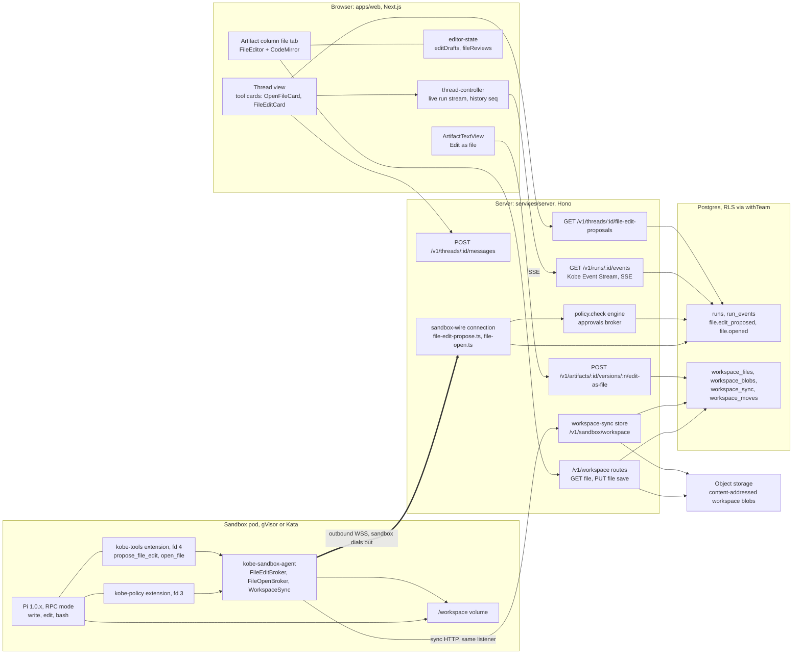
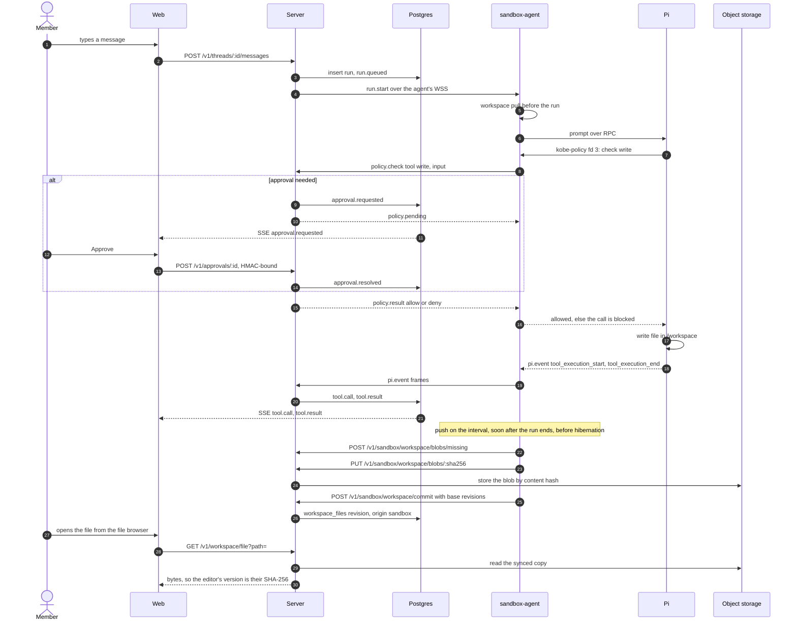
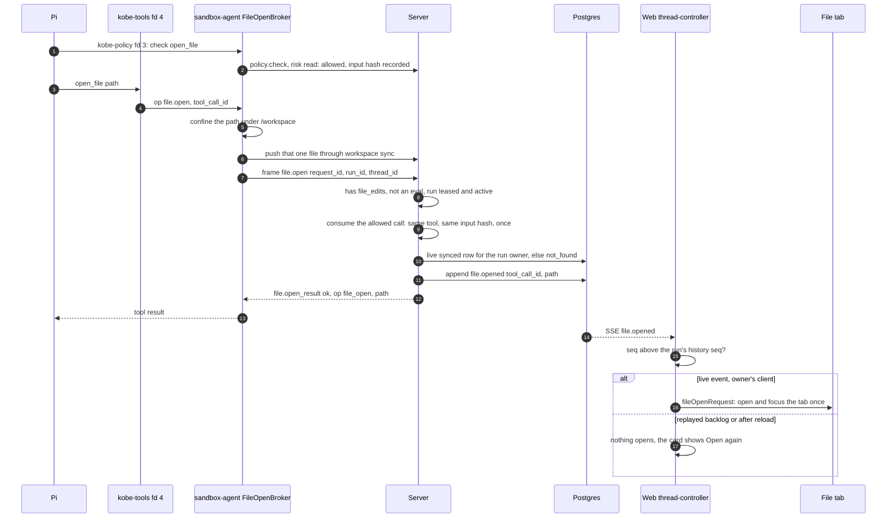
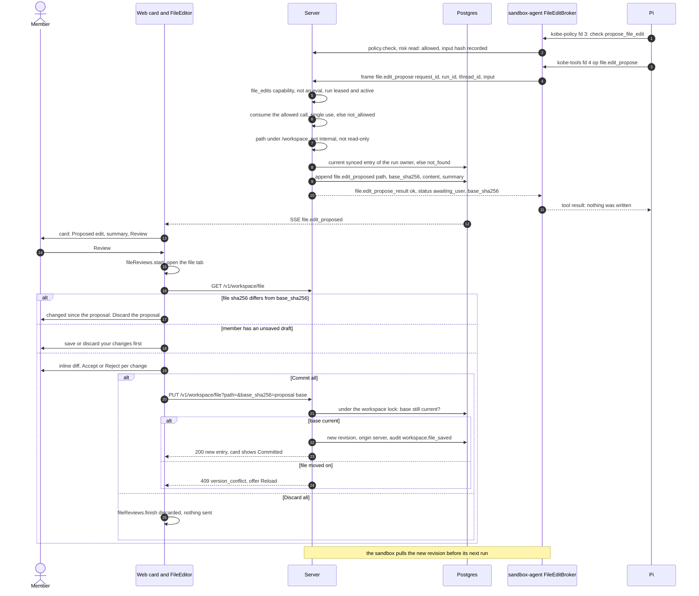
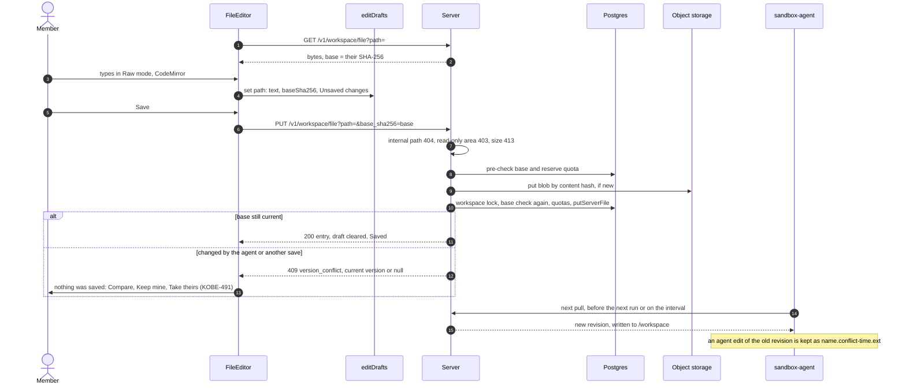
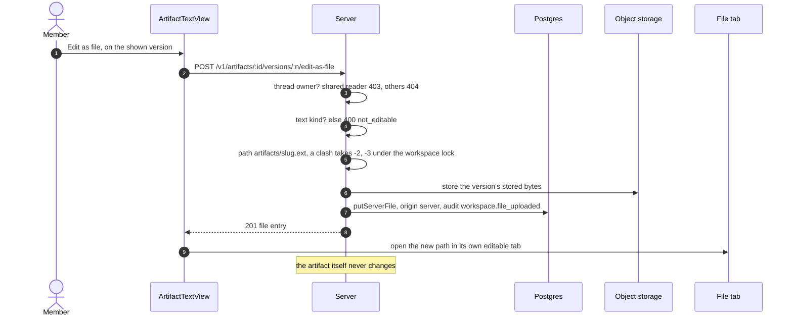
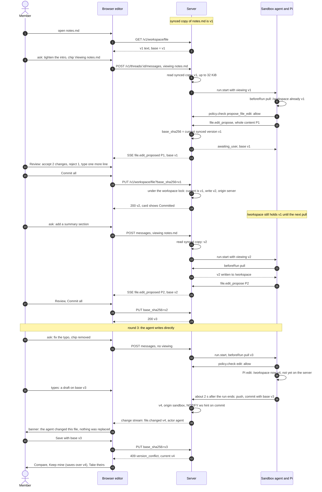
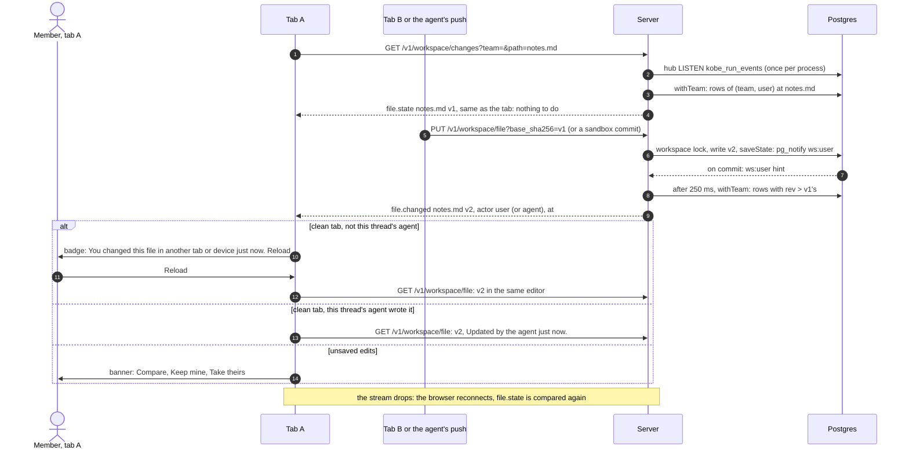

# File editing with the agent

How a member and the agent create and edit workspace files together in Kobe's code editor: the
file tab in the artifact column, with CodeMirror for raw text. Audience: engineers and the product
owner. Contract and decisions FE1–FE13: `docs/specs/file-editor.md`; protocol types:
`packages/protocol/src/file-editor.ts` and `packages/protocol/src/file-open.ts`.

## 1. Overview

What a member can do today (on `main`):

- **The agent creates or changes a file.** Pi's built-in `write` and `edit` tools (and `bash`) run
  in the sandbox against `/workspace`. Every call is decided by the server first. Workspace sync
  then copies the file to the server, and it shows up in the member's file browser.
- **The agent opens a file for the member** (`open_file`, KOBE-484). The file's tab opens and
  takes focus in the artifact column: text files open in the editor, other types in their viewers.
- **The agent proposes an edit for review** (`propose_file_edit`, KOBE-462/463). The proposal
  writes nothing. The member reviews an inline diff, accepts or rejects each change, then picks
  **Commit all** or **Discard all**.
- **The member edits and saves the file** in the editor's Raw mode. A save names the version it
  was based on, so a concurrent change is never overwritten.
- **Edit as file** (KOBE-485). A text artifact (markdown, code, csv) is copied into the member's
  workspace as `artifacts/<slug>.<ext>`. That copy can then be edited like any other file.

In progress (not merged on `main`):

- KOBE-488: badges under the thread title for the files the agent wrote.
- KOBE-489: a switch that opens proposed edits for review automatically.

## 2. Architecture

| Component                | Location                                                                                        | Responsibility                                                                                                                          |
| ------------------------ | ----------------------------------------------------------------------------------------------- | --------------------------------------------------------------------------------------------------------------------------------------- |
| Tool cards               | `apps/web/components/files/open-file-card.tsx`, `file-edit-card.tsx`                            | "Opened <name>" with Open again; "Proposed edit" with Review. Built only from the server's events or lists.                             |
| File tab                 | `apps/web/components/files/file-tab.tsx`                                                        | Reads the synced copy (`GET /v1/workspace/file`, text up to 1 MB) and picks a viewer or the editor.                                     |
| File editor              | `apps/web/components/files/file-editor.tsx`, `code-editor.tsx`                                  | Rendered and Raw (CodeMirror) modes, Save, conflict notice, and the proposal review (inline diff).                                      |
| Editor state             | `apps/web/lib/files/editor-state.ts`                                                            | `EditDraftStore` (unsaved drafts plus their base SHA-256) and `FileReviewStore` (one review per file, committed or discarded per call). |
| Thread controller        | `apps/web/lib/chat/thread-controller.ts`                                                        | Streams run events and turns a live `file.opened` into `fileOpenRequest`.                                                               |
| Edit as file             | `apps/web/components/chat/artifact-text-view.tsx`                                               | Owner-only button that calls the edit-as-file route, then opens the new file.                                                           |
| Message route            | `services/server/src/routes/runs.ts`                                                            | Starts a run; the optional `viewing` field names the file the member has open.                                                          |
| Policy check             | `services/server/src/sandbox-wire/policy-check.ts`, `services/server/src/policy/`               | Decides every tool call: allow, deny, or require approval. Records allowed bound calls.                                                 |
| Frame handlers           | `services/server/src/sandbox-wire/file-edit-propose.ts`, `file-open.ts`, `connection.ts`        | `file.edit_propose` and `file.open`: capability, lease, allowed-call hash, single use, path; then append the run event.                 |
| Allowed calls            | `services/server/src/artifacts/allowed.ts`                                                      | SHA-256 of the canonical input of each allowed bound call, consumed once.                                                               |
| Save route               | `services/server/src/routes/workspace-save.ts`, `workspace-files/save.ts`                       | `PUT /v1/workspace/file?path=&base_sha256=`: base-version check under the workspace lock, then a new server revision.                   |
| Proposals list           | `services/server/src/routes/thread-file-edits.ts`                                               | The thread's `file.edit_proposed` events, for the owner only.                                                                           |
| Edit-as-file route       | `services/server/src/routes/artifact-edit-as-file.ts`                                           | Copies a stored artifact version into the owner's workspace through the upload path.                                                    |
| Workspace sync (server)  | `services/server/src/workspace-sync/`                                                           | Manifest, blobs, commit and pull for sandboxes. Brokers every byte to object storage.                                                   |
| kobe-sandbox-agent       | `services/sandbox-agent/src/agent.ts`, `tools/file-edit-broker.ts`, `tools/file-open-broker.ts` | Announces `file_edits`, relays kobe-tools requests as wire frames, answers each request exactly once.                                   |
| kobe-tools tools         | `services/sandbox-agent/src/kobe-tools/file-edit-tool.ts`, `open-file-tool.ts`                  | Model-facing `propose_file_edit` and `open_file`, registered only when `file_edits` is on.                                              |
| Workspace sync (sandbox) | `services/sandbox-agent/src/workspace/sync.ts`                                                  | Restore at startup, pull before each run and periodically, push on an interval, soon after a run ends, and before hibernation.          |

## 3. Flows

### 3a. The agent creates a file

`write` and `edit` are Pi tools with risk `write` and scope `sandbox`
(`packages/protocol/src/tools.ts:86`). In `ask-on-write`, sandbox writes prompt only when the site
setting `promptSandboxWrites` is on (default off, `services/server/src/policy/settings.ts:20`), or
when a site or team ask rule matches. `ask-all` always prompts. In `auto` and scheduled runs,
non-read tools run only when a team allow rule lists them.

To show the file right away, the agent calls `open_file`; that call pushes the file first (3b).

### 3b. The agent opens a file

The live-only rule is in `#liveFileOpen` (`apps/web/lib/chat/thread-controller.ts:587`). A run this
tab started counts nothing as history. For any other run, history is the `last_seq` known when the
stream opened, so a reload or a second tab never reopens old files. A shared reader sees the card
without Open again: the file tab reads the viewer's own workspace, not the owner's.

### 3c. The agent proposes an edit

`propose_file_edit` has risk `read` and scope `kobe`, so `ask-on-write` does not prompt for it. Deny
and ask rules and `ask-all` still apply. The model sends the whole new content, not a patch.

What the agent learns: only the `awaiting_user` tool result. Commit or Discard sends nothing to the
running agent. After a commit, the sandbox's next pull brings the new revision. If the member still
has the file open when they send their next message, the run's context includes a fenced copy of it
(`run.start.viewing`, at most 32 KiB). After a reload the card reads
`GET /v1/threads/:id/file-edit-proposals` (owner only; others get 404), never the tool result the
sandbox relayed.

### 3d. The member edits and saves

The member's save is never lost. If the agent changed the same file meanwhile, the save gets a 409
and the member reloads. If the agent's change is pushed after the member saved, the sandbox keeps
the agent's version beside the file as a conflict copy (`services/sandbox-agent/src/workspace/sync.ts`).

### 3e. Edit as file from a text artifact

The browser sends no bytes: the server copies the version it stored. The copy goes through the
browser upload path, so the same size limit and quotas apply.

### Where people and policy decide

- **Server decides every tool call.** Each Pi tool call, nested ones included, goes through
  kobe-policy (`policy.check`). `require_approval` never reaches the sandbox: it waits with
  `policy.pending` while the member answers. Approvals are HMAC-signed over run, tool call and
  canonical input. Frames for bound tools (`file.edit_propose`, `file.open`) are accepted only for a
  call allowed with the same input hash, and only once.
- **Human in the loop for edits:** `propose_file_edit` writes nothing, and only the member's
  Commit writes. The agent's own `write` and `edit` prompt only as the mode, site setting and rules
  say.
- **Secrets never enter sandboxes.** The sandbox talks only to the server: the wire and sync HTTP.
  It holds no object-storage credentials.
- **The sandbox dials out only.** It accepts no inbound connections.
- **Owner-only writes.** Save, Commit, Edit as file and the proposals list all act on the caller's
  own workspace or thread. Shared readers can read the thread's events, including a proposal's
  content, which is also in the tool call's input. They get no Review, no Open again and no Edit
  as file.
- **RLS.** Every read and write runs in `withTeam()` (`withAppendTx` for event appends) against
  team tables with forced row-level security.

## 4. Collaborating on one file

### The loop

1. **The member opens the file.** When its tab is on screen, the composer shows a removable
   "Viewing <file>" chip (`apps/web/lib/chat/viewing.ts`). Removing the chip keeps it off for that
   file until another file is viewed.
2. **The member asks for a change.** The message carries `viewing: {path}`. The server reads that
   file from the **synced copy** when the message is sent, not from the browser
   (`services/server/src/workspace-files/viewing.ts`). It sends `run.start.viewing` with the path,
   SHA-256, size, up to 32 KiB of text and a `truncated` flag. The agent puts it in **that run's**
   system prompt only, fenced as untrusted data, and tells the model to use `propose_file_edit`
   rather than editing the file itself (`services/sandbox-agent/src/memory/viewing-context.ts:38`).
   A regenerate sends `viewing_from_entry`. The server then reuses the path that prompt's run
   viewed and reads its current content. Unsaved drafts are never part of this context: only
   saved content is.
3. **The agent proposes.** `propose_file_edit` sends the whole new content. The server fixes
   `base_sha256` to the synced copy's current version (3c).
4. **The member reviews.** In the inline diff, each change has Accept and Reject. The document
   stays editable, so the member can type further changes, and **Commit all** saves exactly what is
   shown, at the proposal's base version.
5. **The next round.** The member asks for the next change. Before the run starts, the sandbox
   pulls the committed revision into `/workspace` (`beforeRun`). The new message carries the
   committed text again as viewed-file context, so the next proposal's base is the commit.
6. **Direct writes.** If the agent uses `write` or `edit` instead (for example the file was not
   being viewed, or the model ignored the guidance), the change lands in `/workspace` at once. It
   reaches the server only on the next push: every `workspaceSync.pushIntervalSeconds` (chart
   default 60 s), about 2 s after the run ends, and before hibernation.

   **The open tab follows (KOBE-491, KOBE-496).** The tab compares the synced version with the
   one it shows. A clean tab of **this thread's own agent** reads the change in place ("Updated by
   the agent just now.", cursor and scroll kept). Any other change (see
   [Live changes to an open file](#live-changes-to-an-open-file)) shows a badge with Reload and
   replaces nothing. With unsaved edits nothing is replaced either: the banner offers **Compare**,
   **Keep mine** and **Take theirs**.

### Live changes to an open file

KOBE-496. Every viewer of a file is its owner: `/v1/workspace` serves only the caller's own (team,
user) workspace, and a shared thread's reader opens files from **their own** workspace, never the
owner's (`open-file-card.tsx`). So the cases are the same member in another browser tab or on
another device, their agent in another thread or a schedule (one sandbox per member), and project
files, which every project member has as a server-written, read-only copy
(`services/server/src/projects/mounts.ts`).

- **Signal.** Every manifest change commits through `saveState`
  (`services/server/src/workspace-sync/store.ts`). When the revision moved, it queues
  `pg_notify('kobe_run_events', 'ws:<user id>')` in the same transaction: delivered on commit,
  never for a rollback, ids only. The run event hub (`event-stream/hub.ts`) hears it on its one
  LISTEN connection per server process and wakes that user's change streams. No Redis; Postgres
  stays the record.
- **Stream.** `GET /v1/workspace/changes?team=&path=…` (contract `packages/protocol/src/workspace-changes.ts`),
  one per page for its open text tabs (at most 32 paths; a changed set re-opens it after 300 ms).
  On connect it sends `file.state` for each path; then, 250 ms after a hint, it reads the rows with
  a newer revision and sends `file.changed` with the SHA-256 (null when deleted), the revision, who
  (`agent` for a sandbox push, `user` for the member's own save, upload, move or Edit as file,
  `sync` for a project file, named after the member who added it) and when. Every read runs in
  `withTeam` with the session's own team and user (`workspace-files/changes.ts`), so nothing of
  another member or team can be read. The session and role are rechecked every 30 s, at once when
  the member is removed or deactivated (a `wsa:<user id>` hint), and after the listener
  reconnects. Change streams have their own cap (8 per user per replica), apart from run streams,
  and while the listener is down they re-read every 20 s, not every second.
- **Tab.** A clean tab reads in place only for this thread's own agent: a version this tab's own
  check found after that agent's live write or run end. A stream change by the agent that arrives
  while such a check runs waits for it; if the check ends without finding that version, it is
  offered. Anything else shows the
  badge at the top of the editor, in an always-mounted `role=status` region: "<who> changed this
  file <when>." with **Reload**,
  which reads the file into the same editor (cursor and scroll kept where the text did not change).
  Typing under the badge turns it into the banner. Read-only tabs (project files, uploads) get the
  badge with Reload only. A change found on window focus also gets the badge.
- **Catch-up.** After a dropped stream or sleep the browser reconnects, and the `file.state` of each
  path is compared with the version the tab shows (a deletion too, even once its tombstone is
  collected); a server-ended stream is re-opened after 5, 15, 30, then 60 s, unless the page's team
  is no longer the active one (another tab switched team), which stops it.
- **Limits.** At most 32 open files follow live changes; a tab past that says "Live updates are off
  for this tab" and is checked on window focus only. Actor names are shortened to 200 characters.
- **Not covered.** Notebooks keep their explicit reload. A project file cannot be replaced in place
  (a new upload of the same name is refused), so its change reaches members as a deletion (a clean
  tab closes) and a new file.

### Who sees what, when

| Change                 | The agent sees it                                                                                                                                            | The member sees it                                                                                                                                                                 |
| ---------------------- | ------------------------------------------------------------------------------------------------------------------------------------------------------------ | ---------------------------------------------------------------------------------------------------------------------------------------------------------------------------------- |
| Member's unsaved edits | Never. Drafts stay in the browser session, and the viewed-file context reads the synced copy.                                                                | At once, in their own editor only. A full page reload loses them.                                                                                                                  |
| Member's saved edits   | In `/workspace` after the next pull: before every run, and on each sync interval. In the model's context when the next message is sent with the file viewed. | At once. The tab shows the saved text without reading it back.                                                                                                                     |
| Agent's direct writes  | At once, in `/workspace`.                                                                                                                                    | After the push (interval, about 2 s after the run ends, or before hibernation): an open tab hears it on the change stream. Calling `open_file` pushes the file first and opens it. |
| Agent's proposals      | As its own tool call. It never learns Accept, Reject, Commit or Discard; after a commit it sees the new content as a saved edit.                             | At once, from `file.edit_proposed` on the live stream. After a reload, from the owner-only proposals list for 7 days.                                                              |

### Conflict cases

- **The member has unsaved changes and the agent writes the same file.** The draft keeps its base
  version (`EditDraftStore`), and the tab does not change. When the member saves:
  - If the agent's write was already pushed, the tab's banner said so first, and the save gets 409
    `version_conflict`. The editor says nothing was saved and offers **Compare** (the inline diff,
    Accept or Reject per change), **Keep mine** (saves over exactly the version it named; a newer
    change is refused again) and **Take theirs** (asks before dropping the draft) (KOBE-491).
  - If the agent's write was not pushed yet, the save succeeds, because the server only knows the
    old base. On its next sync the sandbox finds the server's newer revision. It keeps the agent's
    version beside the file as `<name>.conflict-<time><ext>` and takes the member's version
    (`#resolveConflict` and `#pull` in `services/sandbox-agent/src/workspace/sync.ts`).

  **Gap (KOBE-492):** the agent is not told about the conflict copy; it is only logged in the sandbox.

- **The proposal's base is older than the member's save.** If that save was made in this tab, the
  tab's version no longer matches `base_sha256`. The review then shows only "changed since the
  agent proposed this edit … Discard the proposal". If the save was made elsewhere, for example in
  another browser tab, the stale tab still shows the diff. Commit all sends the old base, the
  server finds a newer version under the workspace lock, and the commit gets 409 with Reload. Either
  way nothing is overwritten, and the agent must propose again against the current file (FE10).
- **Two proposals for the same file.** The review store holds one review per file, so Review on the
  second card replaces the first review. If neither proposal was committed, both have the same
  base. Committing one changes the file's version, so the other then shows the stale notice and
  can only be discarded. Each card keeps its Review button until that proposal itself is committed.
- **The member saves while a run is writing.** The save checks only the server's synced copy.
  If the agent's write is not pushed yet, the member's save wins at the path, and the agent's
  version becomes a conflict copy on the next sync (the first case). The interval pull also runs
  during a run, so the file can change under the agent mid-run. If the agent's write was pushed
  first, the member gets 409.
- **A proposal built from unpushed direct writes.** The base is the synced copy, not the
  sandbox's disk. If the agent wrote the file directly and then proposed in the same run before a
  push, the diff also shows the agent's direct edits as proposed changes (this follows from
  `proposeFileEdit`, `services/server/src/sandbox-wire/file-edit-propose.ts:107`).

### Practical guidance

- **Use a proposal when you are working on the file yourself.** Keep the file's tab on screen so
  the Viewing chip is on. The agent is then told to propose instead of writing, and every change
  waits for your Commit.
- **Allow a direct write for new files, generated output or bulk changes** you are not editing.
  Ask the agent to `open_file` the result, or reopen the tab, to see the pushed version.
- **Protect hand edits.** Save before asking for a change: drafts are invisible to the agent, and
  saving is what puts your text into its context. A run that wrote the file updates or badges the
  open tab by itself.
  The guidance to propose is only a prompt instruction: **gap (KOBE-493):** policy does not stop `write` or
  `edit` on a viewed file. For a hard stop, run in `ask-all` mode, or have an admin add an ask rule
  for `write` and `edit`. The site setting that prompts for all sandbox writes
  (`promptSandboxWrites`) is off by default.

## 5. Limits and edge cases

| Limit                    | Value                                                                  | Where                                                                           |
| ------------------------ | ---------------------------------------------------------------------- | ------------------------------------------------------------------------------- |
| Proposed content         | 128 KiB UTF-8, no NUL (`FILE_EDIT_CONTENT_MAX_BYTES`)                  | `packages/protocol/src/file-editor.ts:26`                                       |
| Proposal event as JSON   | 256 KiB (`EVENT_PAYLOAD_MAX_BYTES`); larger: `too_large`               | `packages/protocol/src/events.ts:115`                                           |
| Proposal summary         | 1–500 characters                                                       | `FILE_EDIT_SUMMARY_MAX`                                                         |
| Tool path                | 1024 characters, no control characters, no `..`                        | `FILE_EDIT_PATH_MAX`                                                            |
| Proposals listed         | newest 200 per thread                                                  | `FILE_EDIT_PROPOSALS_MAX`                                                       |
| Viewed-file context      | 32 KiB, then `truncated`                                               | `VIEWING_CONTENT_MAX_BYTES`                                                     |
| Editor text read         | 1 MB; a larger file opens read-only                                    | `apps/web/lib/files/preview.ts:12`                                              |
| Save and Edit as file    | lower of 100 MiB and the sync max file size; workspace and team quotas | `UPLOAD_DEFAULT_MAX_FILE_BYTES`, `services/server/src/routes/workspace-save.ts` |
| In-flight agent requests | proposals 32 (4 per thread), opens 16 (4 per thread)                   | `services/sandbox-agent/src/tools/file-edit-broker.ts`, `file-open-broker.ts`   |

- **Proposal retention.** Proposals are run events, and run events are compacted 7 days after a run
  ends (`services/server/src/retention/compaction.ts`). The card then says the proposal is no longer
  available. The tool call's input stays in the history.
- **Read-only paths.** `projects/` and `uploads/` are server-owned: Save gets 403 `read_only`, and a
  proposal gets `read_only`. The exception is a member's own drop directly in `uploads/`.
  `.kobe/` is agent-internal: never synced and always `not_found`. The editor opens read-only
  files with a notice.
- **Proposals need a synced file.** The base is the server's synced copy. A file the agent has just
  written but not yet pushed gets `not_found`, and the agent must save it first.
  `propose_file_edit` pushes nothing; `open_file` pushes the one file before asking.
- **Stale proposals.** If the file changed since the proposal, the review offers only Discard, and
  a racing commit still gets a 409. The agent can propose again against the current content.
- **After a reload.** No tab opens by itself. `OpenFileCard` shows Open again, and `FileEditCard`
  reloads the proposal from the owner-only list. Unsaved drafts and reviews live in the chat
  session (`editor-state.ts`), not in the browser's storage or the server, so a full page reload
  loses them. A tab or thread switch keeps them, and the column warns before a draft is lost.
- **Run state.** A `file.open` or `file.edit_propose` after the run ended is refused `not_allowed`.
  Skill-eval sandboxes never open or propose edits to member files.
- **Shared threads.** Readers see both cards read-only. The proposals list returns 404 to anyone
  but the owner.
- **Files made by `bash`.** They sync like any other file, but no tool card names them, because a
  shell command has no file path argument the UI can show. Nothing on `main` records which tool
  wrote a file: a revision only records origin `sandbox` or `server`. KOBE-488 (in progress) adds
  badges for agent-written files.
- **Sync off.** Without object storage, the sandbox has no sync. `open_file` then opens whatever
  synced copy the server has, if any.
